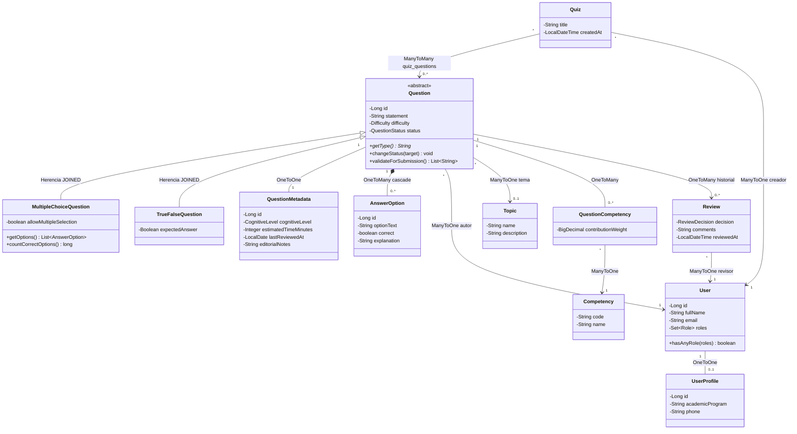
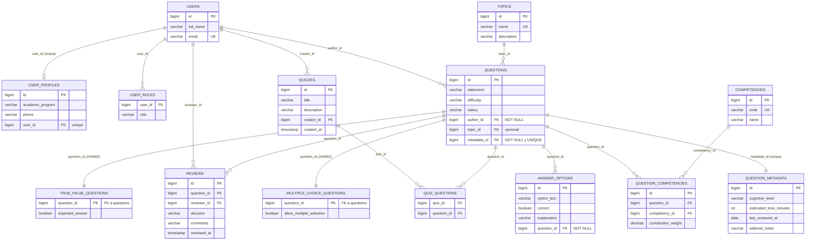
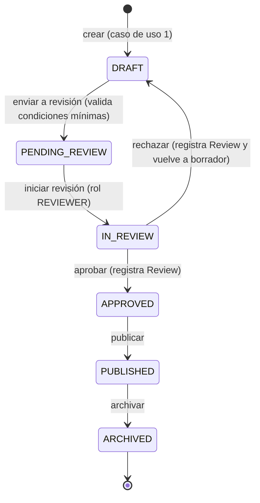

# Banco de Preguntas Saber Pro — Persistencia limpia con JPA

Proyecto del **Taller 10 – JPA** (Laboratorio de Ingeniería de Software II, Universidad del Cauca, 2026.2).
Implementa el Banco de Preguntas para las pruebas Saber Pro aplicando **persistencia limpia**: el modelo
de dominio no conoce JPA y toda la tecnología de persistencia vive en la capa de infraestructura.

**Integrantes:** Ivan Alexander Lopez Lasso · Santiago Caicedo · Adrian Araujo
**Docente:** Ing. Paola Andrea Bedoya Toro

---

## Propósito

Construir, revisar, publicar y utilizar preguntas para simulacros de evaluación, demostrando que:

- Las clases de dominio **no importan `jakarta.persistence`** ni contienen anotaciones JPA.
- Los repositorios del dominio expresan **contratos independientes de la tecnología** y sus
  implementaciones concretas usan Spring Data JPA.
- Se mapean las **cuatro clases de relación** (1-1, 1-N, N-1, N-N) y la **herencia JOINED**.
- Las reglas de negocio (ciclo de vida, roles, composición de cuestionarios) se validan
  transaccionalmente en la capa de aplicación y dentro del modelo de dominio.

## Tecnología

| Componente | Versión |
|---|---|
| Java | 17 |
| Spring Boot | 3.4.5 |
| Spring Web / Spring Data JPA / Hibernate | 3.4.5 |
| H2 (base de datos en memoria) | runtime |
| Maven | 3.8+ |

## Arquitectura en capas

```text
src/main/java/com/example/questionbank/
├── api/                          Presentación HTTP
│   ├── QuestionController        Casos de uso de preguntas (crear, consultar, clasificar, enviar a revisión)
│   ├── ReviewController          Transiciones del ciclo de vida (iniciar/aprobar/rechazar/publicar/archivar)
│   ├── QuizController            Casos de uso de cuestionarios
│   ├── CatalogController         Usuarios, temas y competencias
│   └── GlobalExceptionHandler    Traduce reglas violadas a códigos HTTP
├── application/                  Casos de uso; solo depende de contratos del dominio
│   ├── QuestionService
│   ├── ReviewService
│   ├── QuizService
│   └── CatalogService
├── domain/                       Modelo de negocio SIN JPA
│   ├── model/                    Question, MultipleChoiceQuestion, TrueFalseQuestion, AnswerOption,
│   │                             QuestionMetadata, User, UserProfile, Topic, Competency,
│   │                             QuestionCompetency, Quiz, Review + enums (QuestionStatus, Difficulty, Role, ReviewDecision)
│   └── repository/               Contratos: QuestionRepository, UserRepository, TopicRepository,
│                                 CompetencyRepository, QuizRepository, ReviewRepository
└── infrastructure/jpa/           Implementación concreta con JPA
    ├── record/                   Entidades JPA (QuestionRecord y jerarquía JOINED, UserRecord, ...)
    ├── repository/               Interfaces Spring Data (internas, nunca expuestas a la aplicación)
    ├── mapper/DomainMapper       Traducción dominio ↔ JPA
    └── *RepositoryJpa            Implementaciones de los contratos del dominio
```

**Reglas de dependencia:** `api` → `application` → `domain` ← `infrastructure`. Los servicios de
aplicación invocan los contratos de `domain.repository`; las interfaces Spring Data y las anotaciones
JPA quedan confinadas a `infrastructure`. No es arquitectura hexagonal: es una arquitectura en capas
con inversión de dependencias únicamente en el límite del repositorio.

## Diagrama de clases UML

El mismo diagrama se entrega como PNG (exportado de Draw.io) en el informe oficial. Version navegable:



## Modelo relacional



## Ciclo de vida de una pregunta



Las transiciones válidas viven en el enum de dominio `QuestionStatus.canTransitionTo(...)`;
el servicio valida además las reglas de negocio (condiciones mínimas, roles) dentro de una
transacción. Solo las preguntas `PUBLISHED` pueden incorporarse a un cuestionario.

## Mapeo de las cuatro relaciones y de la herencia

| Concepto | Clases | Mapeo JPA |
|---|---|---|
| Uno a uno | `Question` ↔ `QuestionMetadata` | `@OneToOne` con `@JoinColumn(name="metadata_id", unique=true, nullable=false)`; la llave foránea vive en `questions`, cascada y `orphanRemoval` |
| Uno a muchos | `Question` → `AnswerOption` | `@OneToMany(mappedBy="question", cascade=ALL, orphanRemoval=true)` sobre `answer_options.question_id` |
| Muchos a uno | `Question` → `User` / `Topic` | `@ManyToOne(fetch=LAZY)` + `@JoinColumn(author_id|topic_id)` |
| Muchos a muchos | `Quiz` ↔ `Question` | `@ManyToMany` + `@JoinTable(name="quiz_questions")` con dos foráneas |
| Entidad asociativa (reto) | `QuestionCompetency` | Tabla `question_competencies` con `contribution_weight`, dos `@ManyToOne` + dos `@OneToMany`, unique (question, competency) |
| Herencia | `Question` → MCQ / TrueFalse | `@Inheritance(strategy = JOINED)` sobre `questions` + tablas de subtipo por `@PrimaryKeyJoinColumn` |
| Roles | `User` ↔ `Role` | `@ElementCollection` + `@CollectionTable(name="user_roles")` (catálogo fijo) |

## Ejecución

Requisitos: JDK 17+, Maven 3.8+.

```bash
mvn clean test          # ejecuta las 21 pruebas de integración y unitarias
mvn spring-boot:run     # levanta la API en http://localhost:8080
```

Consola H2: `http://localhost:8080/h2-console` — JDBC URL `jdbc:h2:mem:questionbankdb;DB_CLOSE_DELAY=-1`,
usuario `sa`, contraseña vacía. El esquema se recrea en cada arranque (`create-drop`).

## Casos de uso y ejemplos

### 0. Preparar catálogos

```bash
curl -X POST http://localhost:8080/api/users -H "Content-Type: application/json" \
  -d '{"fullName":"Laura Restrepo","email":"laura@example.com","roles":["AUTHOR"],"program":"Ingenieria de Sistemas","phone":"3001112233"}'

curl -X POST http://localhost:8080/api/users -H "Content-Type: application/json" \
  -d '{"fullName":"Raul Gomez","email":"raul@example.com","roles":["REVIEWER"],"program":"Ingenieria de Sistemas","phone":""}'

curl -X POST http://localhost:8080/api/users -H "Content-Type: application/json" \
  -d '{"fullName":"Claudia Munoz","email":"claudia@example.com","roles":["TEACHER"],"program":"Licenciatura","phone":""}'

curl -X POST http://localhost:8080/api/topics -H "Content-Type: application/json" \
  -d '{"name":"Arquitectura de software","description":"Capas, patrones y persistencia"}'

curl -X POST http://localhost:8080/api/competencies -H "Content-Type: application/json" \
  -d '{"code":"COMP-DIS","name":"Diseno de soluciones de software","description":"Construye soluciones desde requisitos"}'
```

### 1. Crear una pregunta (con autor, metadatos y opciones)

```bash
curl -X POST http://localhost:8080/api/questions -H "Content-Type: application/json" -d '{
  "statement": "What does the JOINED inheritance strategy produce in the relational schema of the bank?",
  "difficulty": "MEDIUM",
  "type": "MULTIPLE_CHOICE",
  "authorId": 1,
  "allowMultipleSelection": false,
  "options": [
    {"text": "Option A: a wrong distractor", "correct": false, "explanation": "Review JOINED"},
    {"text": "Option B: base and subtype tables", "correct": true, "explanation": "Correct"},
    {"text": "Option C: a single table", "correct": false, "explanation": "That is SINGLE_TABLE"},
    {"text": "Option D: one table per class", "correct": false, "explanation": "That is TABLE_PER_CLASS"},
    {"text": "Option E: no tables", "correct": false, "explanation": "JPA needs tables"}
  ],
  "metadata": {"cognitiveLevel": "UNDERSTAND", "estimatedTimeMinutes": 3, "editorialNotes": null}
}'
```

### 2. Consultar preguntas

```bash
curl http://localhost:8080/api/questions
curl http://localhost:8080/api/questions/1
curl "http://localhost:8080/api/questions?status=DRAFT"
curl http://localhost:8080/api/questions/author/1
```

### 3. Clasificar una pregunta (tema + competencias con pesos que suman 100 %)

```bash
curl -X POST http://localhost:8080/api/questions/1/classify -H "Content-Type: application/json" -d '{
  "topicId": 1,
  "competencies": [{"competencyId": 1, "weight": 60}, {"competencyId": 2, "weight": 40}]
}'
```

### 4. Enviar a revisión y ejecutar el ciclo de vida

```bash
curl -X POST http://localhost:8080/api/questions/1/submit-review
curl -X POST http://localhost:8080/api/questions/1/start-review -H "Content-Type: application/json" \
  -d '{"reviewerId": 2, "comments": "Taking it"}'
curl -X POST http://localhost:8080/api/questions/1/approve -H "Content-Type: application/json" \
  -d '{"reviewerId": 2, "comments": "Clear statement and options"}'
curl -X POST http://localhost:8080/api/questions/1/publish
curl http://localhost:8080/api/questions/1/reviews
```

Rechazar devuelve la pregunta a `DRAFT` y registra el historial:

```bash
curl -X POST http://localhost:8080/api/questions/1/reject -H "Content-Type: application/json" \
  -d '{"reviewerId": 2, "comments": "The statement is ambiguous"}'
```

### 5. Crear un cuestionario (solo preguntas PUBLISHED)

```bash
curl -X POST http://localhost:8080/api/quizzes -H "Content-Type: application/json" \
  -d '{"title":"Simulacro Saber Pro","description":"Práctica","creatorId":3,"questionIds":[1]}'
curl http://localhost:8080/api/quizzes
curl -X POST http://localhost:8080/api/quizzes/1/questions/2   # rechaza preguntas no publicadas (HTTP 409)
```

## Pruebas

`mvn test` ejecuta 21 pruebas (casos de éxito y de error) contra H2:

| # | Prueba | Qué valida | Resultado esperado |
|---|---|---|---|
| 1 | test01 PersistAndReloadMultipleChoiceQuestion | Grafo completo se guarda y recupera (opciones, metadatos, tema, autor, competencia) | Éxito |
| 2 | test02 PersistAndReloadTrueFalseQuestion | Subtipo true/false persiste y recupera su valor de verdad | Éxito |
| 3 | test03 JOINEDStrategyCreatesBaseAndSubtypeTables | JOINED materializa `questions` + tablas de subtipo | Éxito |
| 4 | test04 DeleteQuestionCascadesToOwnedData | Eliminar pregunta borra opciones, metadatos y aportes | Éxito |
| 5 | test05 MetadataUniqueConstraintPreventsSharing | Restricción única impide compartir metadatos (1-1) | Error |
| 6 | test06 QuestionWithUnknownAuthorRejected | Foránea inválida rechazada al resolver el autor | Error |
| 7 | test07 ManyToManyQuizJoinTableStoresBothDirections | `quiz_questions` guarda la N-N en ambos sentidos | Éxito |
| 8 | test08 QuestionCompetencyWeightsPersisted | Entidad asociativa persiste y actualiza pesos (60/40) | Éxito |
| 9 | test09 SubmitValidQuestionForReview | DRAFT → PENDING_REVIEW con condiciones mínimas | Éxito |
| 10 | test10 SubmitIncompleteQuestionFails | Envío incompleto lista violaciones y no cambia estado | Error |
| 11 | test11 InvalidTransitionIsRejected | Prohibido saltar estados (DRAFT → APPROVED) | Error |
| 12 | test12 FullLifecycleUntilArchived | Cadena completa DRAFT→…→ARCHIVED + historial | Éxito |
| 13 | test13 RejectReturnsQuestionToDraft | Rechazo regresa a DRAFT y registra revisión | Éxito |
| 14 | test14 OnlyReviewersCanApprove | Sin rol REVIEWER no se puede aprobar | Error |
| 15 | test15 CreateQuizWithPublishedQuestions | Cuestionario con preguntas publicadas | Éxito |
| 16 | test16 QuizRejectsNotPublishedQuestions | Cuestionario aborta con preguntas no publicadas | Error |
| 17 | test17 AddingDraftQuestionToQuizFails | Agregar borrador a cuestionario se rechaza | Error |
| 18 | test18 FindPublishedByCompetency | Consulta publicadas por competencia (contrato) | Éxito |
| 19 | test19 FindQuestionsByStatusAndByAuthor | Consultas por estado y por autor | Éxito |
| 20 | test20 ServiceRunsEndToEndWithoutJpa | El servicio funciona con repositorios en memoria (sin JPA ni Spring) | Éxito |
| 21 | test21 ServiceRejectsIncompleteSubmissionWithoutJpa | Reglas del dominio válidas sin base de datos | Error |

Las pruebas 20-21 demuestran que los **contratos de repositorio** pueden probarse sin acoplar
el dominio a JPA: se implementan repositorios falsos en memoria y el mismo `QuestionService`
funciona sin base de datos.

## Decisiones de diseño

- **Metadatos obligatorios**: toda pregunta nace con su registro de metadatos (nivel cognitivo y
  tiempo estimado); la foránea es `NOT NULL` y `UNIQUE`, lo que garantiza el 1-1 exacto.
- **Opciones regidas por reglas académicas**: selección única exige 5 opciones (4 distractores +
  1 correcta); selección múltiple exige al menos 2 opciones y 1 correcta. Se validan al enviar a
  revisión, no al guardar el borrador.
- **Entidad asociativa para pesos**: como la relación pregunta–competencia necesita el porcentaje
  de contribución (los pesos deben sumar 100 %), se promovió a la entidad `QuestionCompetency`
  con dos relaciones 1-N / N-1. En cambio, quiz–pregunta no necesita atributos extra y quedó como
  `@ManyToMany` directa con tabla intermedia `quiz_questions`.
- **JOINED elegido** frente a SINGLE_TABLE y TABLE_PER_CLASS: los subtipos tienen pocos atributos
  propios pero el banco se consulta por estado y tipo con frecuencia; JOINED evita columnas nulas,
  mantiene normalización y no requiere uniones de todas las tablas.
- **Roles como enum + tabla de colección**: los 5 roles del enunciado son un catálogo fijo sin
  atributos adicionales; una entidad `Role` completa se justificaría solo si los roles se
  administraran en ejecución.

## Notas

- Las respuestas HTTP usan records de transporte (`QuestionResponse`, `QuizResponse`, ...): los
  objetos de dominio nunca cruzan la frontera de la API.
- `GlobalExceptionHandler` traduce: identidad inexistente → 404, regla de negocio violada → 409,
  restricción de integridad → 409.
- Para producción se recomendaría agregar seguridad, DTOs de entrada completos, migraciones
  (Flyway) y pruebas de controladores.
